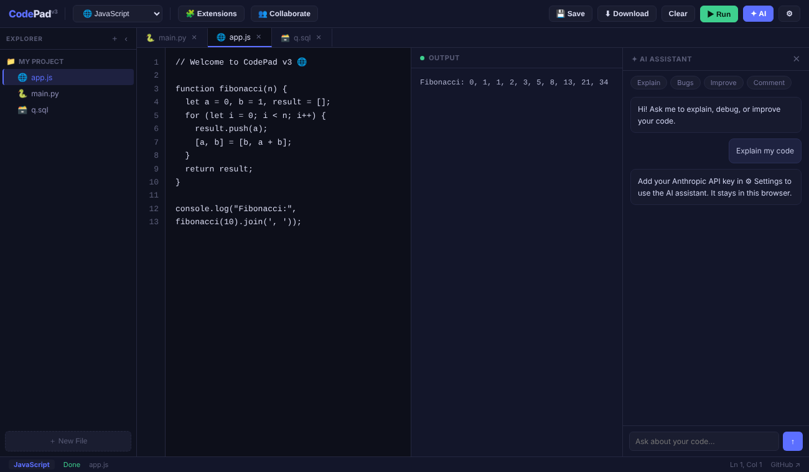
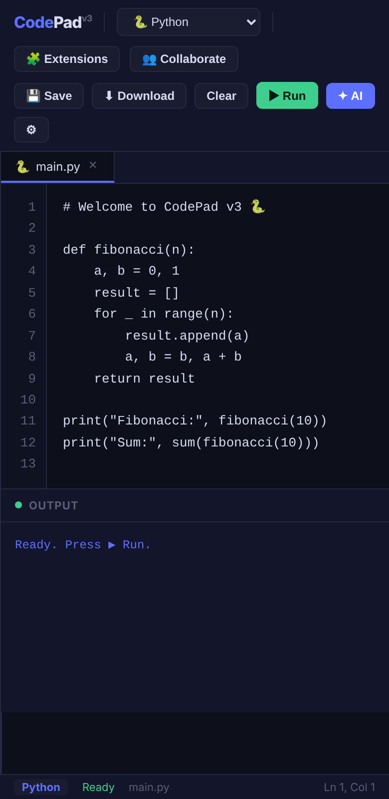

# CodePad v3 — Lightweight Browser IDE

**A complete code editor in one 55 KB file.** Open it in any browser on Windows, macOS, Linux or ChromeOS and start writing and running Python, JavaScript and SQL. Nothing to install, no account, no server.

**[▶ Open CodePad v3](https://tejashalo.github.io/codepad-v3/)** · [Project report (UPES minor project)](#project-report)



## Why it's different

| | CodePad v3 | Typical IDE (e.g. VS Code + Python) |
|---|---|---|
| Download size | **55 KB** single HTML file | 100–400 MB installers |
| Install | None. Open the file or the link | Installer + language toolchains |
| Works on | **Any OS with a modern browser** — Windows, macOS, Linux, ChromeOS, even tablets | Separate builds per OS |
| Runtimes | Load **only when you first run** a language (Python ≈10 MB once, SQLite ≈1 MB once), then cached by the browser | Always installed |
| Backend | None — everything runs on your device | Local install / cloud workspace |

The same file behaves identically on a Windows laptop and a MacBook: shortcuts accept both **Ctrl** and **⌘** (`Ctrl/⌘ + S` to save, `Ctrl/⌘ + Enter` to run), files are stored in the browser, and code runs in WebAssembly, so there are no OS-specific paths or toolchains.

## Features

- **Editor** — multi-file tabs with unsaved-change dot, line numbers, Tab indentation, cursor position, file download.
- **File explorer** — create and delete files; files persist in the browser (localStorage) between visits.
- **Run code in the browser**
  - **Python 3** via [Pyodide](https://pyodide.org/) (CPython compiled to WebAssembly)
  - **JavaScript** natively
  - **SQL** via [sql.js](https://sql.js.org/) (real SQLite in WebAssembly) — install it from 🧩 Extensions
  - Java and C++ files can be created and edited; in-browser running is planned
- **Live collaboration between tabs** — host a session, join with a 6-character code from another tab or window of the same browser and edits sync instantly (BroadcastChannel API, works offline).
- **AI assistant** — Explain / Find bugs / Improve / Comment your code with Claude. Add your own Anthropic API key in ⚙ Settings; it is kept only in your browser and sent only to `api.anthropic.com`.
- **Responsive** — usable on phones and tablets (editor and output stack vertically).

<p align="center"></p>

## Run it

**Online:** **https://tejashalo.github.io/codepad-v3/**

**Offline / on your own computer (Windows or Mac):**
1. Download this repo (**Code → Download ZIP**) and unzip it.
2. Double-click `index.html`. That's it.

The editor, JavaScript and collaboration work fully offline. Python and SQL need an internet connection the first time you run them so the browser can download and cache the runtime.

Optional local server (any OS):

```bash
python -m http.server 8080   # then open http://localhost:8080
```

## How it works

| Part | Implementation |
|---|---|
| UI | Plain HTML + CSS + JavaScript, no framework, no build step |
| File system | `localStorage` (JSON map of file name → language + content) |
| Python | Pyodide 0.25.1, loaded from jsDelivr on first run |
| SQL | sql.js 1.10.3, loaded from cdnjs when the extension is installed |
| JavaScript | `new Function()` with captured `console.log` |
| Collaboration | `BroadcastChannel` — host sends the document, peers send edits |
| AI | Anthropic Messages API called directly from the browser with the user's own key |

```
index.html            the whole app (HTML + CSS + JS)
docs/screenshots/     images used in this README
```

## Project report

CodePad v3 was built as a minor project for the B.Tech CSE (Cloud Computing & Virtualization Technology) programme at **UPES, Dehradun** (July–November 2025) by:

- Tejas Saxena

## Roadmap

- Syntax highlighting (CodeMirror)
- Java and C++ execution (WebAssembly toolchains)
- Cross-device collaboration (WebRTC / WebSocket)
- Import/export of whole projects as ZIP
- Light theme

## License

MIT — see [LICENSE](LICENSE).
